# 🌐 Integrated Campus Network Configuration


> 📌 **Project Overview:** Enterprise campus network design and implementation featuring hierarchical switching, link aggregation via LACP EtherChannel, IEEE 802.1Q trunking, and Inter-VLAN routing using Router-on-a-Stick.

---

## 🏗️ Phase 1: Physical Topology Setup

### 🔹 Step 1.1: Deploying Network Devices
First, the required network hardware components were placed into the logical workspace to establish a hierarchical campus architecture (**Core/Distribution** and **Access** layers):

* 🔀 **1x Cisco 2911 Router:** Acts as the central Layer 3 gateway for Inter-VLAN routing (*Router-on-a-Stick*).
* 🖧 **3x Cisco 2960 Switches:** One core/distribution switch (`SW1`) and two access-layer switches (`SW2`, `SW3`) serving end users.
* 💻 **6x End Devices (PCs):** Representing workstations across three isolated departments (**Admin**, **Engineering**, and **Students**).

<br>

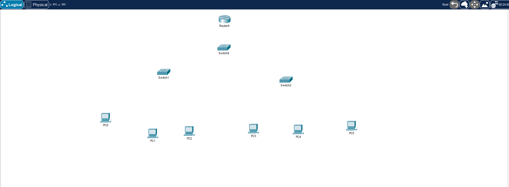

---

### 🔹 Step 1.2: Labeling Network Devices
Each device's display name was updated to match a standardized naming convention (`R1`, `SW1`, `SW2`, `SW3`, and `PC1`–`PC6`). 

> 💡 **Why this matters:** Clear physical labeling prevents configuration mix-ups during CLI setup and significantly speeds up link troubleshooting.

<br>

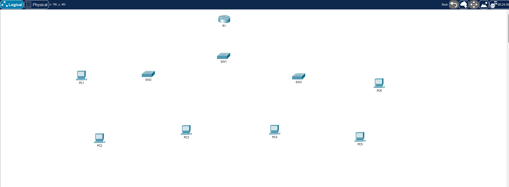

---

### 🔹 Step 1.3: Cabling & Port Assignment
Physical connections were established using the appropriate Ethernet media based on device layer and port signaling (**MDI** vs. **MDI-X**):

| Connection | Source Port | Destination Port | Cable Type | Engineering Justification |
| :--- | :---: | :---: | :--- | :--- |
| **R1 ↔ SW1** | `G0/0` | `G0/1` | 🟨 Straight-Through | Connects unlike devices (Layer 3 Router to Layer 2 Switch). **GigabitEthernet** ports prevent bandwidth bottlenecks since all Inter-VLAN traffic traverses this single uplink. |
| **SW1 ↔ SW2** | `Fa0/1`–`Fa0/2` | `Fa0/1`–`Fa0/2` | 🟦 Cross-Over | Connects like devices (Switch-to-Switch). Two parallel FastEthernet links aggregate bandwidth and provide redundancy via **LACP EtherChannel**. |
| **SW1 ↔ SW3** | `Fa0/3`–`Fa0/4` | `Fa0/1`–`Fa0/2` | 🟦 Cross-Over | Connects like devices using sequential uplink ports (`Fa0/3-4` on SW1) for clean port management and future LACP bundling. |
| **SW2 ↔ PC1–PC3** | `Fa0/10`–`Fa0/12` | `Fa0` | 🟨 Straight-Through | Connects unlike devices (Switch to End-Host). Ports `Fa0/10`–`Fa0/12` isolate end devices from lower-numbered trunk/uplink ports. |
| **SW3 ↔ PC4–PC6** | `Fa0/10`–`Fa0/12` | `Fa0` | 🟨 Straight-Through | Mirrors SW2's port allocation scheme (`Fa0/10`–`Fa0/12`) for symmetrical access-layer standardization across the campus. |

<br>

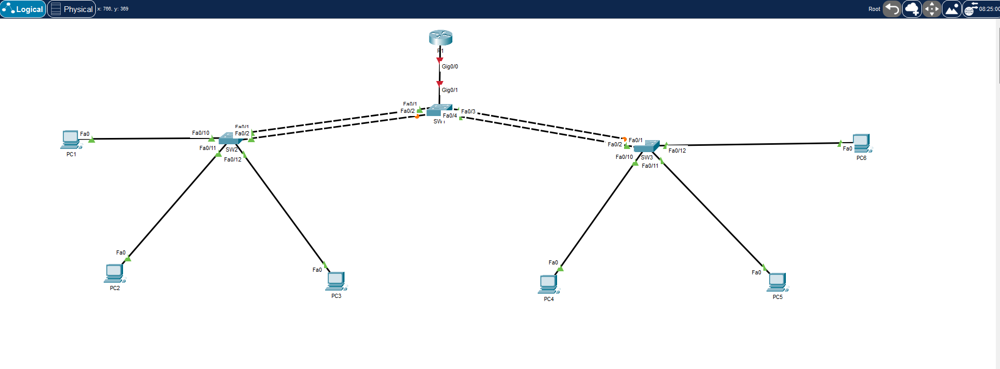

---
## 🌐 Phase 2: IP Addressing Scheme & End-Device Configuration

All network subnets follow the assigned unique identifier **`K = 71`** using a `/24` (`255.255.255.0`) subnet mask across three isolated departmental VLANs:

* 🏢 **VLAN 10 (ADMIN):** `10.71.10.0/24` — Gateway: `10.71.10.1`
* ⚙️ **VLAN 20 (ENGINEERING):** `10.71.20.0/24` — Gateway: `10.71.20.1`
* 🎓 **VLAN 30 (STUDENTS):** `10.71.30.0/24` — Gateway: `10.71.30.1`

### 🔹 Step 2.1: Complete IP Addressing Table

| Device | Interface / VLAN | IP Address | Subnet Mask | Default Gateway |
| :--- | :---: | :---: | :---: | :---: |
| **R1** | `G0/0.10` (VLAN 10) | `10.71.10.1` | `255.255.255.0` | `N/A` |
| **R1** | `G0/0.20` (VLAN 20) | `10.71.20.1` | `255.255.255.0` | `N/A` |
| **R1** | `G0/0.30` (VLAN 30) | `10.71.30.1` | `255.255.255.0` | `N/A` |
| **SW1** | `VLAN 10` (Mgmt) | `10.71.10.2` | `255.255.255.0` | `10.71.10.1` |
| **SW2** | `VLAN 10` (Mgmt) | `10.71.10.3` | `255.255.255.0` | `10.71.10.1` |
| **SW3** | `VLAN 10` (Mgmt) | `10.71.10.4` | `255.255.255.0` | `10.71.10.1` |
| **PC1** | `Fa0` (VLAN 10) | `10.71.10.11` | `255.255.255.0` | `10.71.10.1` |
| **PC2** | `Fa0` (VLAN 20) | `10.71.20.11` | `255.255.255.0` | `10.71.20.1` |
| **PC3** | `Fa0` (VLAN 30) | `10.71.30.11` | `255.255.255.0` | `10.71.30.1` |
| **PC4** | `Fa0` (VLAN 10) | `10.71.10.12` | `255.255.255.0` | `10.71.10.1` |
| **PC5** | `Fa0` (VLAN 20) | `10.71.20.12` | `255.255.255.0` | `10.71.20.1` |
| **PC6** | `Fa0` (VLAN 30) | `10.71.30.12` | `255.255.255.0` | `10.71.30.1` |

### 🔹 Step 2.2: Configuring Host IP Settings
Static IPv4 addresses, subnet masks, and default gateways were configured on all six end devices (`PC1`–`PC6`) via **Desktop > IP Configuration**:

| PC1 (VLAN 10 - Admin) | PC2 (VLAN 20 - Engineering) | PC3 (VLAN 30 - Students) |
| :---: | :---: | :---: |
| 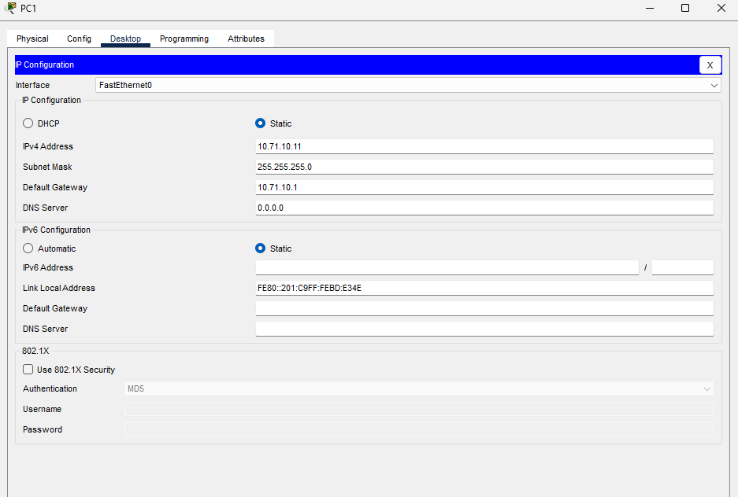 | 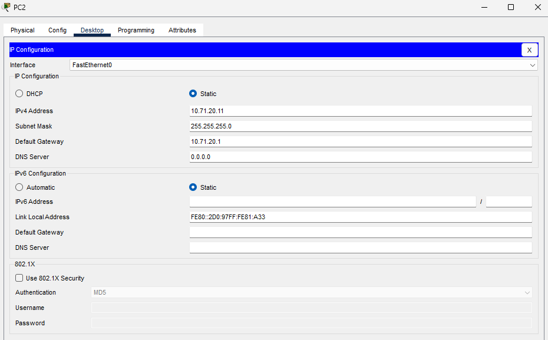 | 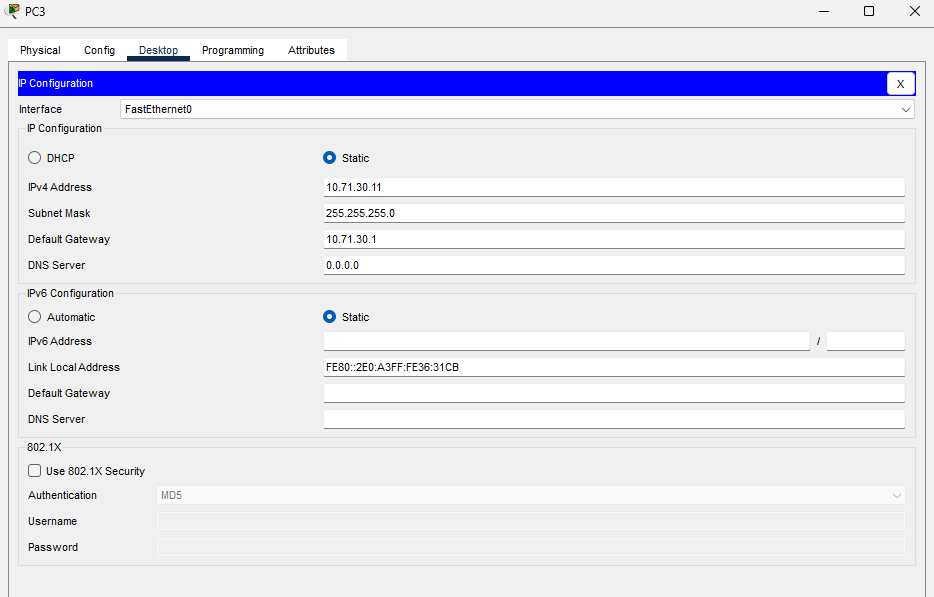 |

| PC4 (VLAN 10 - Admin) | PC5 (VLAN 20 - Engineering) | PC6 (VLAN 30 - Students) |
| :---: | :---: | :---: |
| 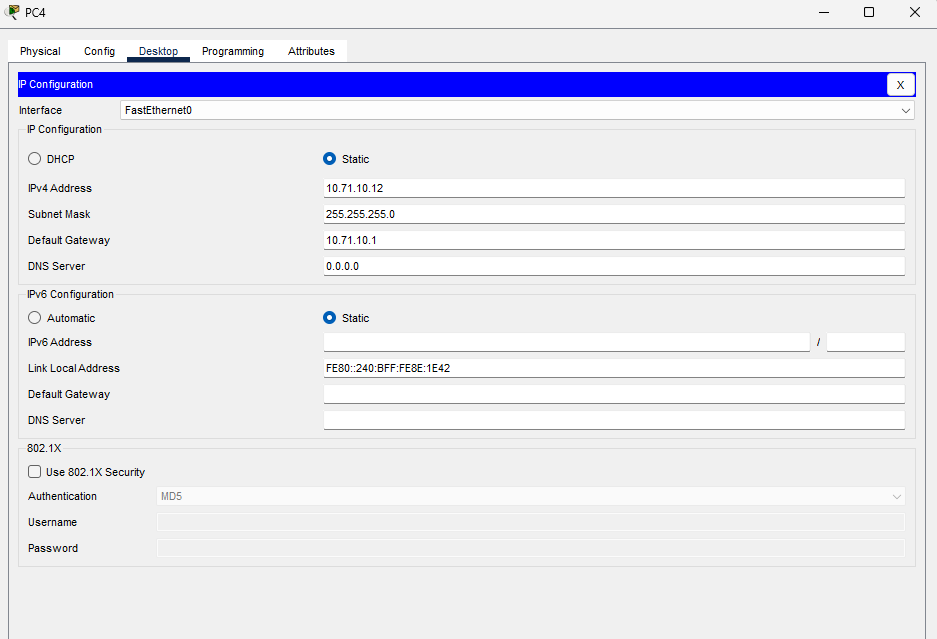 | 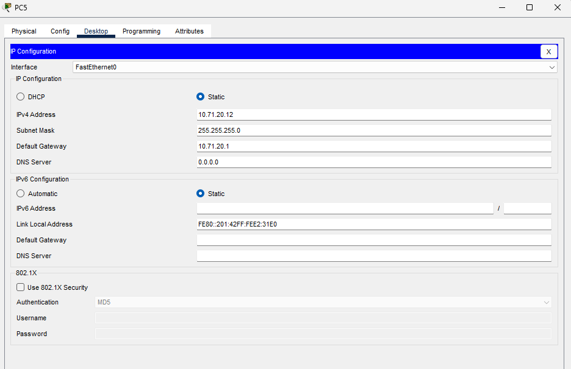 | 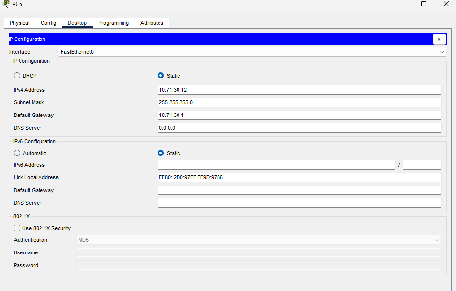 |

---
## 🔐 Phase 3: Initial Router Configuration (`R1`)

After configuring the IP addresses for all six PCs, we move to the central router (`R1`) via the **CLI**. At startup, type `no` to bypass the initial configuration dialog and configure the device manually.

---

### 1️⃣ Entering Configuration Mode

First, elevate privileges and open global configuration mode:

```bash
enable
configure terminal
```

- `enable` — Moves from User EXEC Mode (`>`) to Privileged EXEC Mode (`#`).
- `configure terminal` — Enters Global Configuration Mode (`config)#`.

---

### 2️⃣ Assigning Device Hostname

Sets a unique name for the router:

```bash
hostname R1
```

- Changes the default prompt from `Router` to `R1`.

---

### 3️⃣ Securing Privileged Access

Protects administrative mode with an encrypted password:

```bash
enable secret cisco123
```

- Sets an encrypted password required to enter Privileged EXEC Mode.

---

### 4️⃣ Configuring Console Line Authentication

Secures direct physical access to the router:

```bash
line console 0
password cisco
login
exit
```

- `line console 0` — Selects the physical console port.
- `password cisco` — Assigns the console login password.
- `login` — Enables password authentication.
- `exit` — Returns to Global Configuration Mode.

---

### 5️⃣ Configuring VTY Line Authentication

Secures remote virtual terminal sessions (Telnet/SSH):

```bash
line vty 0 4
password cisco
login
exit
```

- `line vty 0 4` — Selects the five remote VTY lines.
- `password cisco` — Sets the remote login password.
- `login` — Enforces password authentication.
- `exit` — Returns to Global Configuration Mode.

---

### 6️⃣ Warning Banner & Password Encryption

Adds a legal warning message and encrypts plain-text line passwords:

```bash
banner motd # Authorized Access Only! #
service password-encryption
```

- `banner motd` — Displays a warning before authentication.
- `service password-encryption` — Encrypts plain-text line passwords in the configuration.

---

### 7️⃣ Saving the Configuration

Saves all changes permanently:

```bash
end
write memory
```

- `end` — Exits directly to Privileged EXEC Mode.
- `write memory` — Saves the running configuration to NVRAM.

> ✅ **Verification:** Type `exit` and press **Enter**. The MOTD banner should appear, followed by a prompt for the console password, confirming that the initial configuration is working properly.

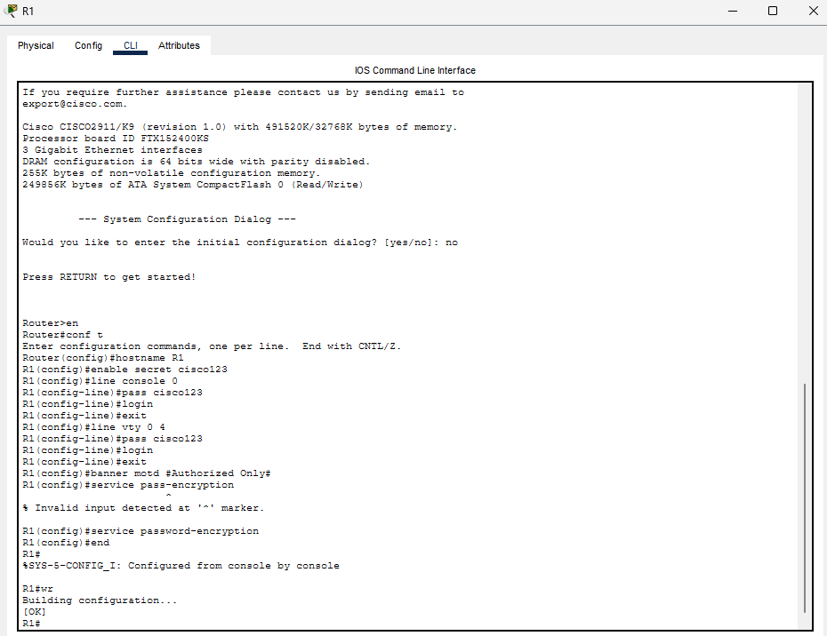

---
## 🔐 Phase 4: Initial Switch Configuration (`SW1`, `SW2`, `SW3`)

Next, we apply the same baseline security and administrative configurations to all three switches (`SW1`, `SW2`, and `SW3`) via the **CLI**. Unlike the router, Cisco 2960 switches skip the initial setup dialog—just press **Enter** to begin.

---

### 1️⃣ Entering Configuration Mode
Elevate privileges and open global configuration mode:

> `enable`  
> `configure terminal`

- `enable` — Moves from User EXEC Mode (`>`) to Privileged EXEC Mode (`#`).
- `configure terminal` — Enters Global Configuration Mode `(config)#`.

---

### 2️⃣ Assigning Switch Hostnames
Sets a unique name for each switch (`SW1`, `SW2`, and `SW3`):

> `hostname SW1`

- Changes the default prompt from `Switch` to `SW1` (repeat using `SW2` and `SW3` on the other switches).

---

### 3️⃣ Securing Privileged Access
Protects administrative mode with an encrypted password:

> `enable secret cisco123`

- Sets an encrypted password required to enter Privileged EXEC Mode.

---

### 4️⃣ Configuring Console Line Authentication
Secures direct physical console access to each switch:

> `line console 0`  
> `password cisco123`  
> `login`  
> `exit`

- `line console 0` — Selects the physical console port.
- `password cisco123` — Assigns the console login password.
- `login` — Enables password authentication.
- `exit` — Returns to Global Configuration Mode.

---

### 5️⃣ Configuring VTY Line Authentication
Secures all remote virtual terminal sessions on the switch:

> `line vty 0 15`  
> `password cisco123`  
> `login`  
> `exit`

- `line vty 0 15` — Selects all 16 remote VTY lines supported by Cisco 2960 switches.
- `password cisco123` — Sets the remote login password.
- `login` — Enforces password authentication.
- `exit` — Returns to Global Configuration Mode.

---

### 6️⃣ Warning Banner & Password Encryption
Adds a legal warning message and encrypts plain-text line passwords:

> `banner motd #Authorized Only#`  
> `service password-encryption`

- `banner motd` — Displays a warning message before login.
- `service password-encryption` — Encrypts plain-text line passwords in the configuration file.

---

### 7️⃣ Saving the Configuration
Saves all changes permanently to NVRAM:

> `end`  
> `write memory`

- `end` — Exits directly to Privileged EXEC Mode.
- `write memory` — Saves the running configuration to NVRAM.

> ✅ **Verification:** Type `exit` and press **Enter** on each switch. The MOTD banner should appear, followed by a password prompt confirming that console authentication is active.

### 📸 Switch CLI Screenshots

| Core Switch (`SW1`) | Access Switch (`SW2`) | Access Switch (`SW3`) |
| :---: | :---: | :---: |
| 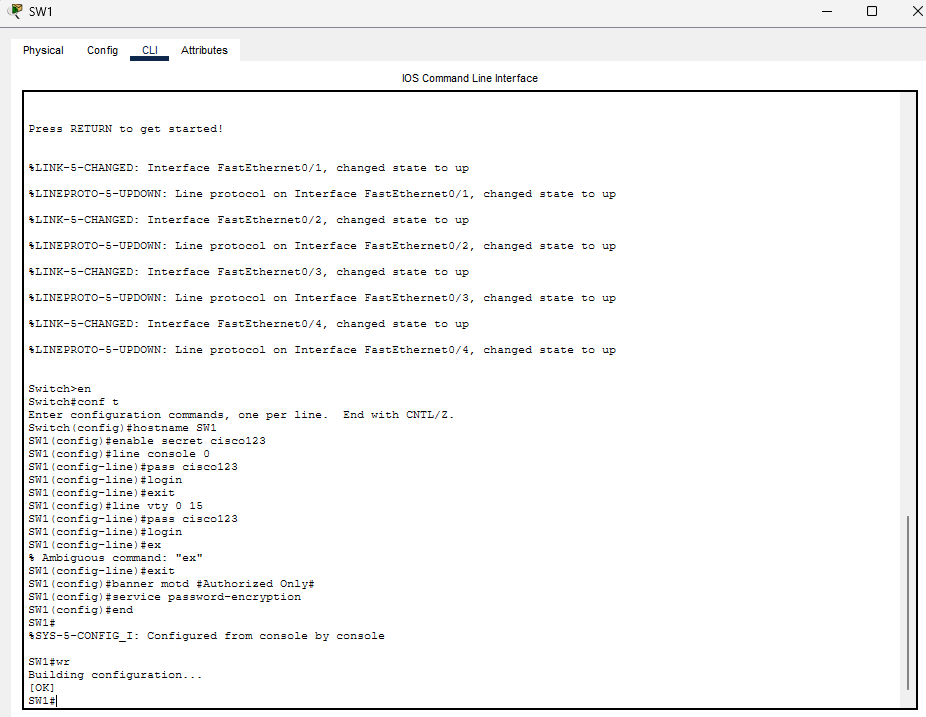 | 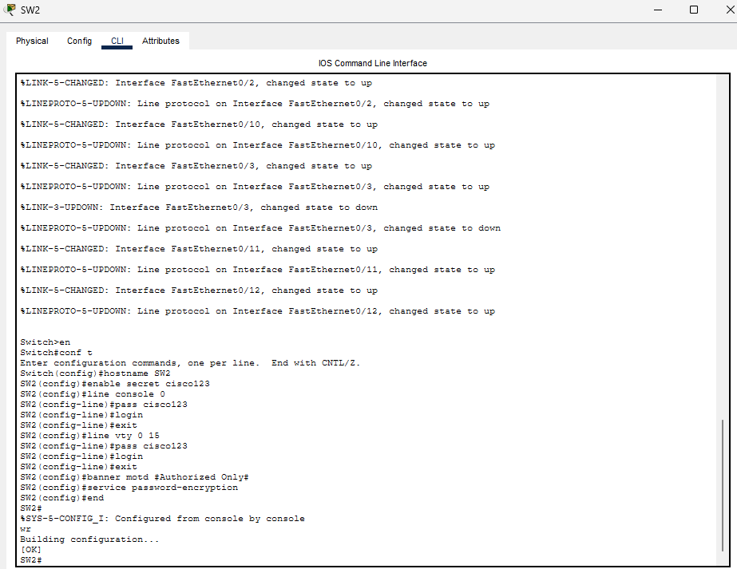 | 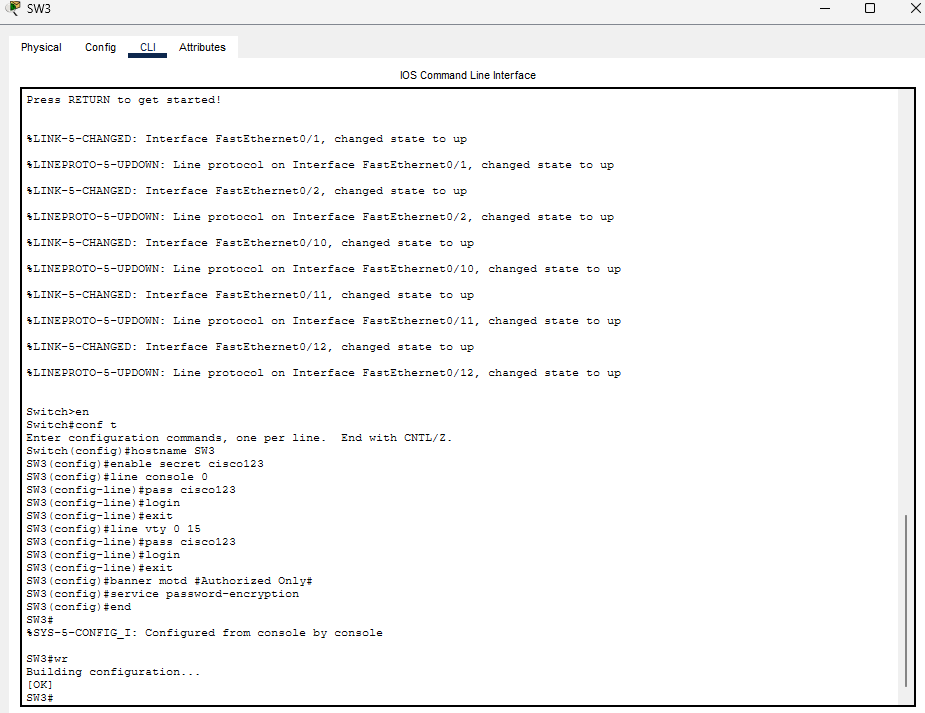 |

---
## 🏷️ Phase 5: VLANs & Access Port Configuration

In this phase, we logically segment the campus network into three isolated broadcast domains (**ADMIN**, **ENGINEERING**, and **STUDENTS**) across all switches, and assign each end-device port on the access switches to its corresponding VLAN.

---

### 1️⃣ Creating VLANs on All Switches (`SW1`, `SW2`, `SW3`)
Create only the three required VLANs with identical IDs and names on `SW1`, `SW2`, and `SW3` (leaving VLAN 1 as the default native VLAN):

> `configure terminal`  
> `vlan 10`  
> `name ADMIN`  
> `vlan 20`  
> `name ENGINEERING`  
> `vlan 30`  
> `name STUDENTS`  
> `end`  
> `write memory`

- `vlan 10 / 20 / 30` — Creates the virtual LAN database entries on each switch.
- `name ADMIN / ENGINEERING / STUDENTS` — Assigns descriptive departmental names to each VLAN.
- `end` & `write memory` — Exits configuration mode and saves the VLAN settings.

---

### 2️⃣ Configuring Access Ports on `SW2` & `SW3`
Assign the PC-facing interfaces (`Fa0/10`, `Fa0/11`, `Fa0/12`) on both `SW2` (`PC1`–`PC3`) and `SW3` (`PC4`–`PC6`) as static access ports:

> `configure terminal`  
> `interface fa0/10`  
> `switchport mode access`  
> `switchport access vlan 10`  
> `interface fa0/11`  
> `switchport mode access`  
> `switchport access vlan 20`  
> `interface fa0/12`  
> `switchport mode access`  
> `switchport access vlan 30`  
> `end`  
> `write memory`

- `interface fa0/10` (and `fa0/11`, `fa0/12`) — Selects the specific physical interface connected to an end device.
- `switchport mode access` — Forces the port into permanent access mode for end-host connectivity (disabling dynamic trunking).
- `switchport access vlan <ID>` — Assigns the access port to its designated departmental VLAN.

---

### 3️⃣ Verifying VLANs & Port Assignments
Run the following verification command in Privileged EXEC Mode on `SW1`, `SW2`, and `SW3`:

> `show vlan brief`

- `show vlan brief` — Displays all active VLANs, their status, and the physical ports assigned to each VLAN.

> ✅ **Verification:** Confirm that VLANs `10 (ADMIN)`, `20 (ENGINEERING)`, and `30 (STUDENTS)` appear as `active` on all three switches, and that `Fa0/10`, `Fa0/11`, and `Fa0/12` are correctly listed under VLANs `10`, `20`, and `30` respectively on `SW2` and `SW3`.


| Core Switch (`SW1`) | Access Switch (`SW2`) | Access Switch (`SW3`) |
| :---: | :---: | :---: |
| 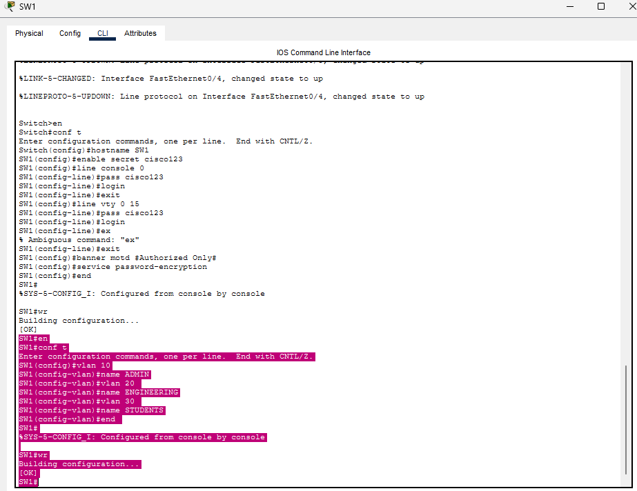 | 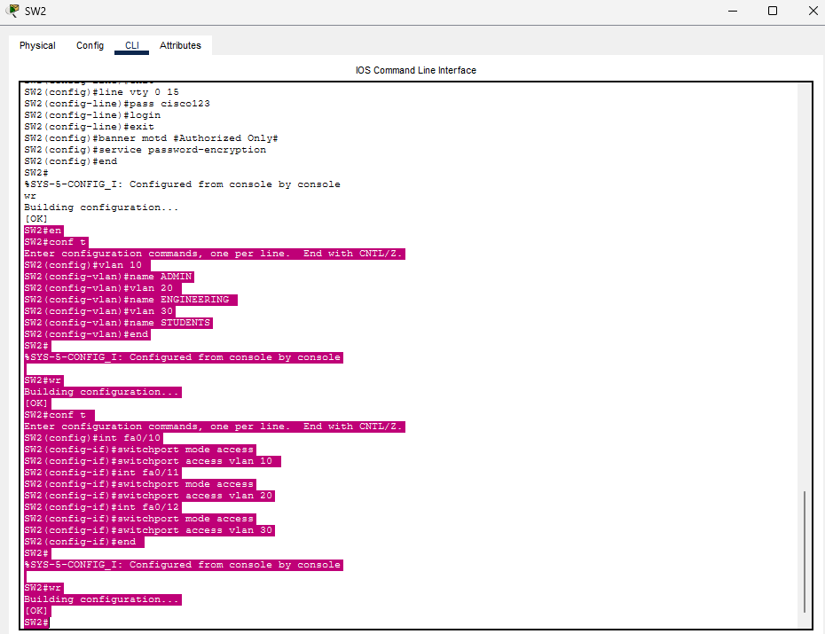 | 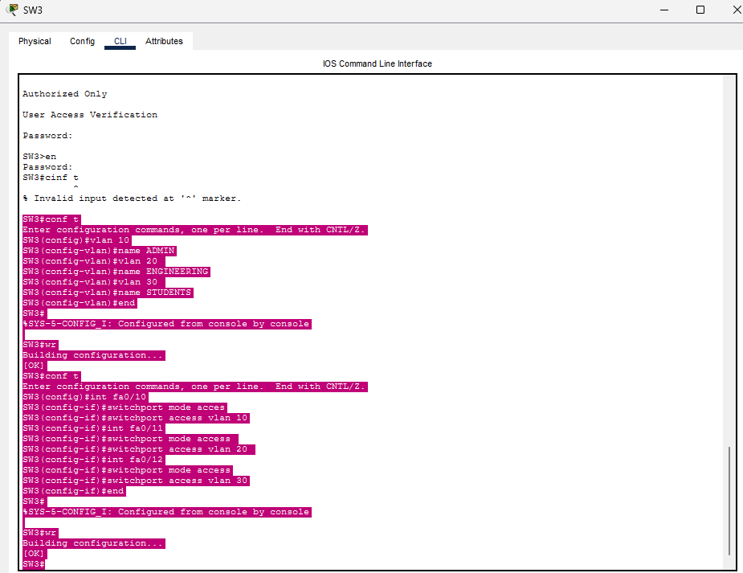 |


### 📸 VLAN Verification Screenshots

| Core Switch (`SW1`) | Access Switch (`SW2`) | Access Switch (`SW3`) |
| :---: | :---: | :---: |
| 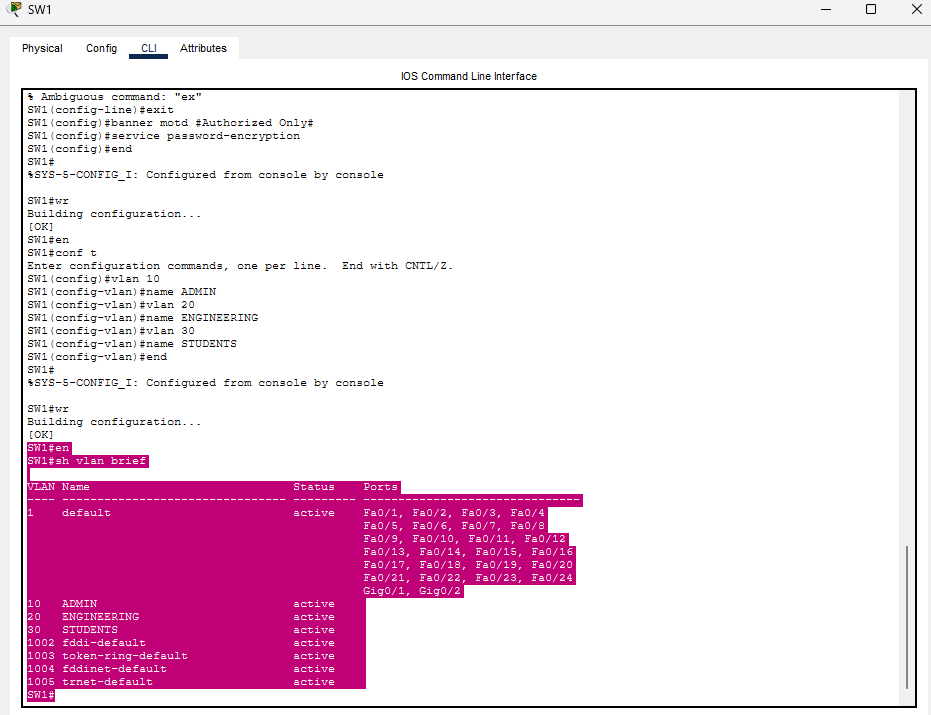 | 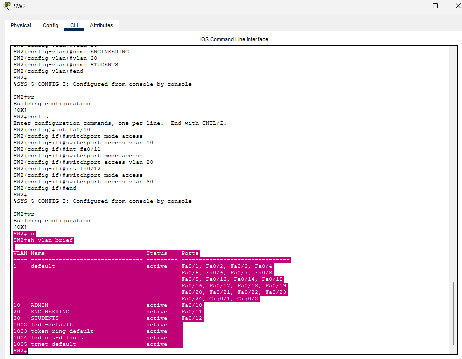 | 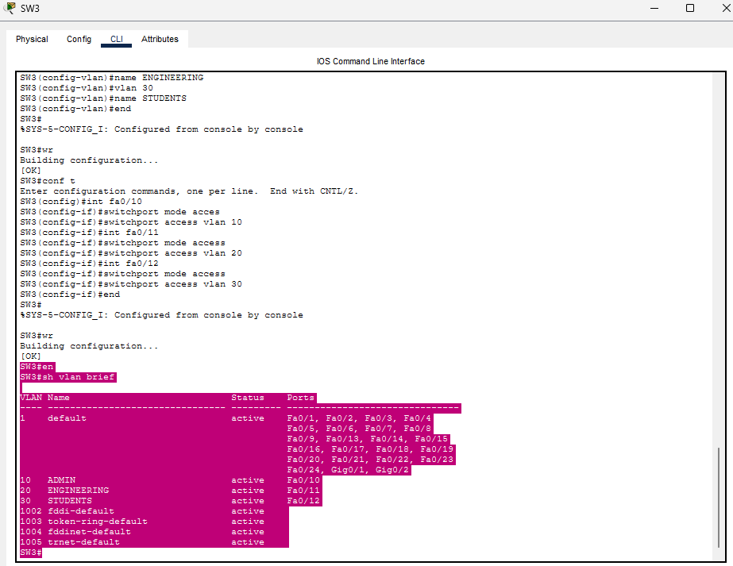 |

---
## 🔗 Phase 6: EtherChannel (LACP) & Trunk Configuration

In this phase, we bundle the redundant physical links between switches into logical **LACP EtherChannel** interfaces (`Port-channel 1` and `Port-channel 2`) for higher bandwidth and fault tolerance. Then, we configure both Port-channels and the router uplink (`SW1 G0/1`) as **IEEE 802.1Q Trunk** links carrying only VLANs `10`, `20`, and `30` while keeping VLAN `1` as the native VLAN.

---

### 1️⃣ Configuring EtherChannel 1 & 2 and Router Trunk on `SW1`
Bundle `Fa0/1–2` into `Port-channel 1` (toward `SW2`), bundle `Fa0/3–4` into `Port-channel 2` (toward `SW3`), and configure both Port-channels plus `G0/1` (toward `R1`) as trunk links:

> `configure terminal`  
> `interface range fa0/1 - 2`  
> `channel-group 1 mode active`  
> `exit`  
> `interface port-channel 1`  
> `switchport mode trunk`  
> `switchport trunk allowed vlan 10,20,30`  
> `exit`  
> `interface range fa0/3 - 4`  
> `channel-group 2 mode active`  
> `exit`  
> `interface port-channel 2`  
> `switchport mode trunk`  
> `switchport trunk allowed vlan 10,20,30`  
> `exit`  
> `interface g0/1`  
> `switchport mode trunk`  
> `switchport trunk allowed vlan 10,20,30`  
> `end`  
> `write memory`

- `interface range fa0/1 - 2` (and `fa0/3 - 4`) — Selects both parallel physical links simultaneously to apply identical EtherChannel settings.
- `channel-group 1 mode active` (and `group 2`) — Creates the logical Port-channel interface and actively negotiates bundling using **LACP**.
- `interface port-channel 1` (and `port-channel 2`) — Enters the logical bundled interface so trunking applies cleanly to the entire channel.
- `switchport mode trunk` — Forces the link into permanent IEEE 802.1Q trunk mode to carry traffic for multiple VLANs.
- `switchport trunk allowed vlan 10,20,30` — Restricts trunk traffic strictly to VLANs 10, 20, and 30 while keeping VLAN 1 as the default native VLAN.
- `interface g0/1` — Configures the GigabitEthernet uplink to `R1` as a trunk to support Router-on-a-Stick.

---

### 2️⃣ Configuring EtherChannel 1 & Trunk on `SW2`
Match the LACP and trunk configuration on `SW2`'s uplink ports (`Fa0/1–2`):

> `configure terminal`  
> `interface range fa0/1 - 2`  
> `channel-group 1 mode active`  
> `exit`  
> `interface port-channel 1`  
> `switchport mode trunk`  
> `switchport trunk allowed vlan 10,20,30`  
> `end`  
> `write memory`

- `channel-group 1 mode active` — Pairs `SW2`'s `Fa0/1–2` with `SW1`'s `Port-channel 1` using LACP Active mode.
- `switchport mode trunk` & `switchport trunk allowed vlan 10,20,30` — Ensures identical trunk settings on both ends of the link.

---

### 3️⃣ Configuring EtherChannel 2 & Trunk on `SW3`
Match the LACP and trunk configuration on `SW3`'s uplink ports (`Fa0/1–2`):

> `configure terminal`  
> `interface range fa0/1 - 2`  
> `channel-group 2 mode active`  
> `exit`  
> `interface port-channel 2`  
> `switchport mode trunk`  
> `switchport trunk allowed vlan 10,20,30`  
> `end`  
> `write memory`

- `channel-group 2 mode active` — Pairs `SW3`'s `Fa0/1–2` with `SW1`'s `Port-channel 2` using LACP Active mode.
- `switchport mode trunk` & `switchport trunk allowed vlan 10,20,30` — Allows VLANs 10, 20, and 30 across the bundled trunk link.

---

### 4️⃣ Verifying EtherChannel & Trunk Status
Run the following verification commands in Privileged EXEC Mode on `SW1`, `SW2`, and `SW3`:

> `show etherchannel summary`  
> `show interfaces trunk`

- `show etherchannel summary` — Confirms that both Port-channels show status **`SU`** (Layer 2, in-use) and all physical member interfaces show **`(P)`** (bundled in port-channel).
- `show interfaces trunk` — Confirms that `Po1`, `Po2`, and `Gig0/1` (once `R1`'s interface is enabled) operate in `trunking` mode with Native VLAN `1` and allowed VLANs `10,20,30`.

### 📸 EtherChannel & Trunk Verification Screenshots

| Core Switch (`SW1`) | Access Switch (`SW2`) | Access Switch (`SW3`) |
| :---: | :---: | :---: |
| 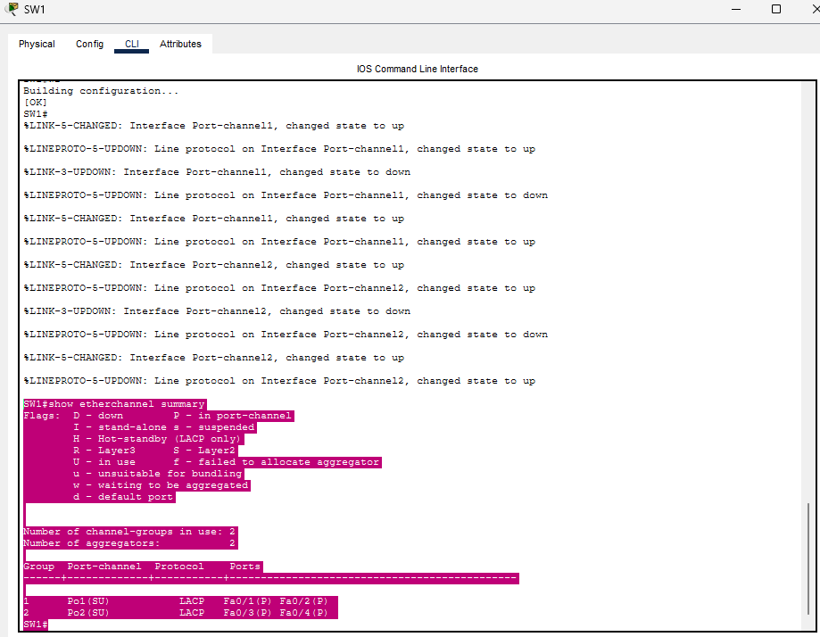 | 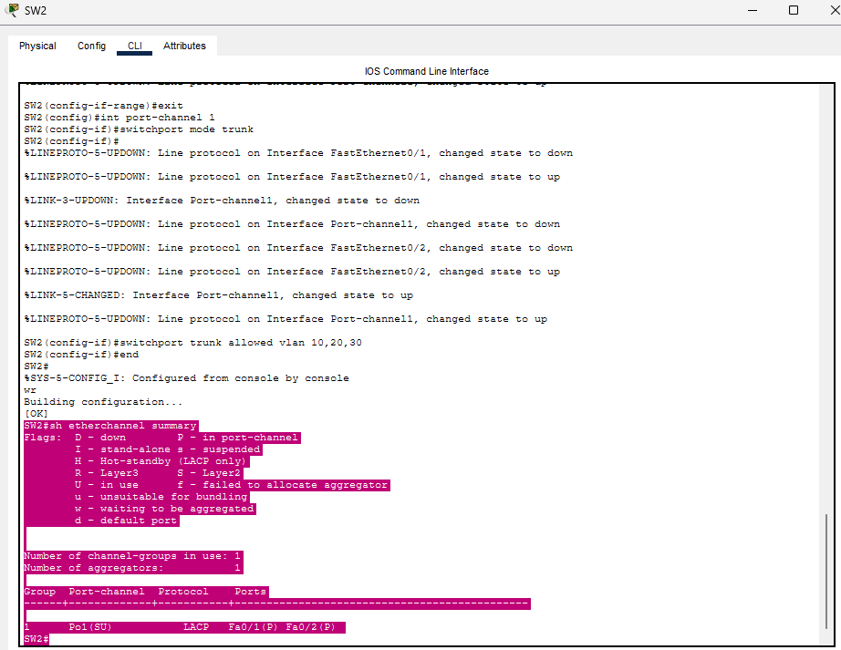 | 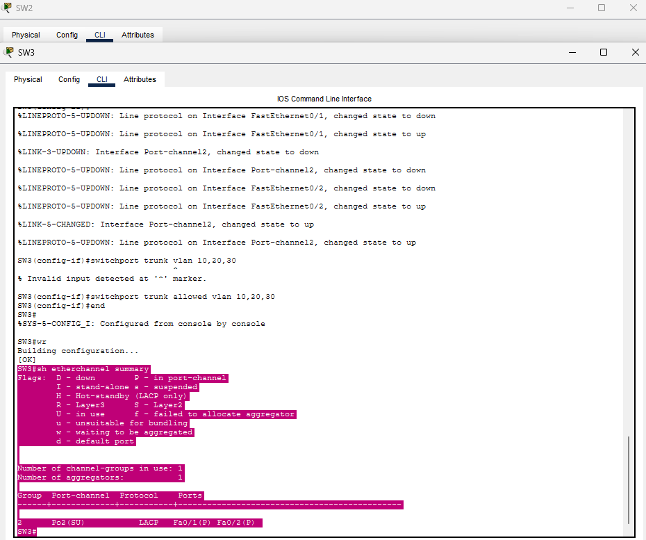 |
| 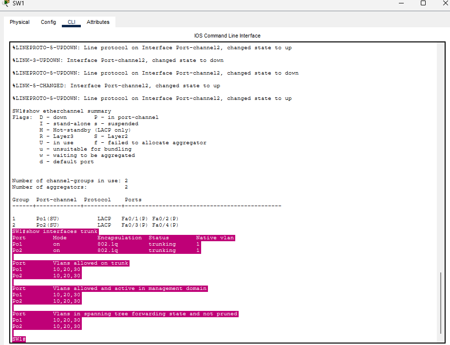 | 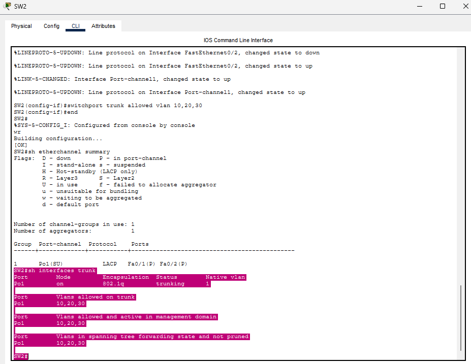 | 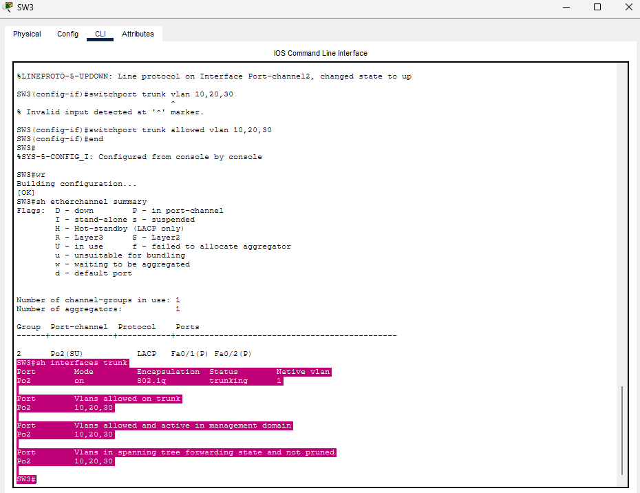 |

---
## 🚀 Phase 7: Switch Management IPs & Inter-VLAN Routing (Router-on-a-Stick)

In this phase, we configure Layer 3 management interfaces (SVIs) on all switches under **VLAN 10**, and implement **Router-on-a-Stick** on `R1` so devices in different VLANs can communicate through dedicated default gateways.

---

### 1️⃣ Configuring Switch Management IPs (`SW1`, `SW2`, `SW3`)
Assign management IP addresses on `VLAN 10` (`10.71.10.2` for `SW1`, `10.71.10.3` for `SW2`, and `10.71.10.4` for `SW3`) and point all switches to the VLAN 10 gateway (`10.71.10.1`):

> `configure terminal`  
> `interface vlan 10`  
> `ip address 10.71.10.2 255.255.255.0`  
> `no shutdown`  
> `exit`  
> `ip default-gateway 10.71.10.1`  
> `end`  
> `write memory`

- `interface vlan 10` — Enters the Switch Virtual Interface (SVI) for VLAN 10 management access.
- `ip address 10.71.10.2 255.255.255.0` — Assigns the management IP to `SW1` (use `10.71.10.3` on `SW2` and `10.71.10.4` on `SW3`).
- `no shutdown` — Administratively enables the management VLAN interface.
- `ip default-gateway 10.71.10.1` — Allows the switch to be managed remotely from other subnets via `R1`.

---

### 2️⃣ Enabling Physical Router Interface (`R1`)
Bring up the physical uplink interface connected to `SW1` without assigning an IP address directly to it:

> `configure terminal`  
> `interface g0/0`  
> `no shutdown`  
> `exit`

- `interface g0/0` — Selects the physical GigabitEthernet interface connected to `SW1 G0/1`.
- `no shutdown` — Powers on the physical interface so its logical subinterfaces can become active.

---

### 3️⃣ Creating Router Subinterfaces for VLANs 10, 20, and 30
Create three logical subinterfaces with IEEE 802.1Q tagging to act as default gateways for each departmental VLAN:

> `interface g0/0.10`  
> `encapsulation dot1q 10`  
> `ip address 10.71.10.1 255.255.255.0`  
> `exit`  
> `interface g0/0.20`  
> `encapsulation dot1q 20`  
> `ip address 10.71.20.1 255.255.255.0`  
> `exit`  
> `interface g0/0.30`  
> `encapsulation dot1q 30`  
> `ip address 10.71.30.1 255.255.255.0`  
> `end`  
> `write memory`

- `interface g0/0.10` (`.20`, `.30`) — Creates logical subinterfaces on `G0/0` matching each VLAN ID.
- `encapsulation dot1q <VLAN_ID>` — Configures IEEE 802.1Q frame tagging so the router recognizes traffic belonging to that specific VLAN.
- `ip address 10.71.<VLAN>.1 255.255.255.0` — Assigns the default gateway IP address for each VLAN subnet.
- `end` & `write memory` — Exits configuration mode and saves the routing configuration to NVRAM.

---

### 4️⃣ Verifying Router Subinterfaces & Routing Table
Run the following verification commands on `R1` in Privileged EXEC Mode:

> `show ip interface brief`  
> `show ip route`

- `show ip interface brief` — Verifies that `GigabitEthernet0/0` and all three subinterfaces (`.10`, `.20`, `.30`) are **`up/up`** with their correct gateway IPs.
- `show ip route` — Confirms that `R1` has directly connected (`C`) routes for all three VLAN subnets (`10.71.10.0/24`, `10.71.20.0/24`, and `10.71.30.0/24`).

### 📸 Router Verification Screenshots

| Interface Verification (`show ip interface brief`) | Routing Table (`show ip route`) |
| :---: | :---: |
| 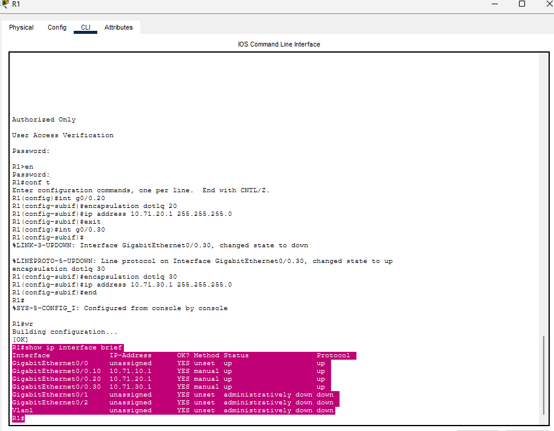 | 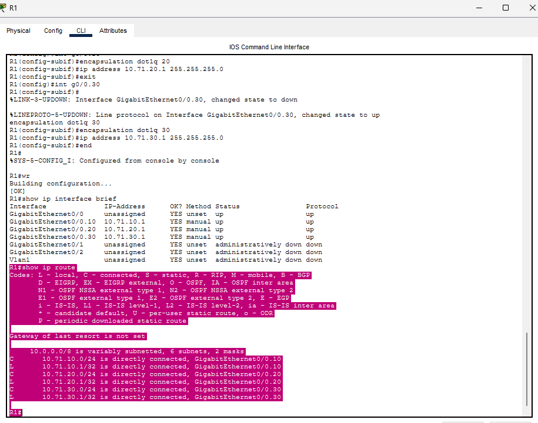 |

---
## 🧪 Phase 8: End-to-End Connectivity Testing & Verification

In the final phase, we verify complete network reachability using **ICMP (`ping`)** tests from the end-device Command Prompts. Testing covers both **Intra-VLAN** communication (same VLAN across different switches via LACP trunks) and **Inter-VLAN** communication (different VLANs routed through `R1`).

---

### 1️⃣ Intra-VLAN Connectivity Tests (Same VLAN Across Switches)
These tests confirm that VLAN tagging, IEEE 802.1Q trunking, and LACP EtherChannel links properly forward Layer 2 traffic between `SW2` and `SW3`:

> `ping 10.71.10.12` *(from PC1 to PC4 — VLAN 10)*  
> `ping 10.71.20.12` *(from PC2 to PC5 — VLAN 20)*  
> `ping 10.71.30.12` *(from PC3 to PC6 — VLAN 30)*

- `PC1 → PC4` — Verifies connectivity across the **ADMIN** VLAN (`10.71.10.0/24`).
- `PC2 → PC5` — Verifies connectivity across the **ENGINEERING** VLAN (`10.71.20.0/24`).
- `PC3 → PC6` — Verifies connectivity across the **STUDENTS** VLAN (`10.71.30.0/24`).

### 📸 Intra-VLAN Ping Screenshots

| PC1 → PC4 (VLAN 10) | PC2 → PC5 (VLAN 20) | PC3 → PC6 (VLAN 30) |
| :---: | :---: | :---: |
| 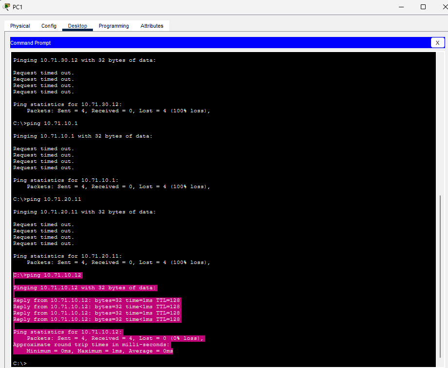 | 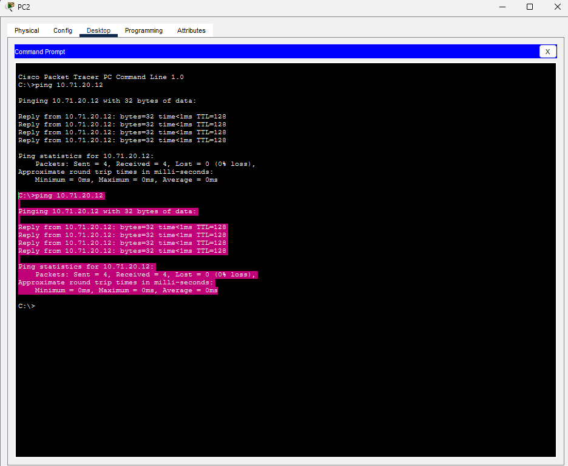 | 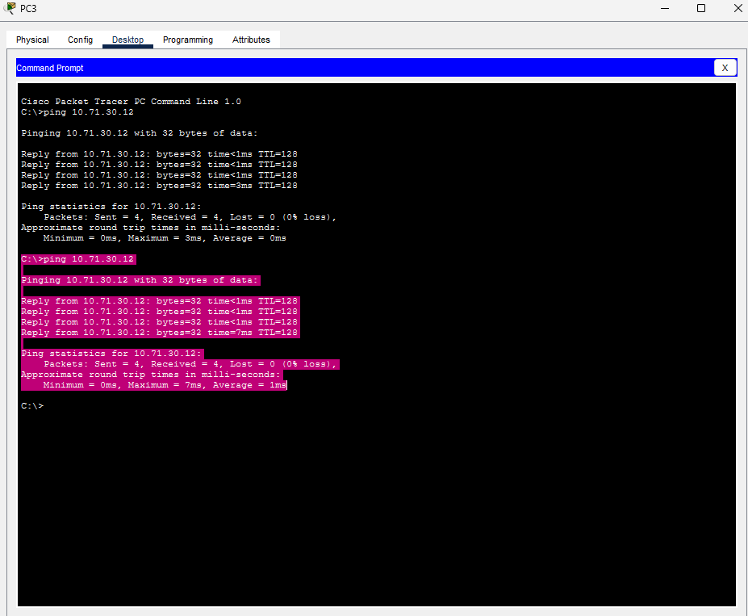 |

---

### 2️⃣ Inter-VLAN Connectivity Tests (Different VLANs via `R1`)
These tests confirm that **Router-on-a-Stick** subinterfaces on `R1` successfully route traffic between isolated departmental subnets:

> `ping 10.71.20.11` *(from PC1 to PC2 — VLAN 10 to VLAN 20)*  
> `ping 10.71.30.11` *(from PC1 to PC3 — VLAN 10 to VLAN 30)*  
> `ping 10.71.30.12` *(from PC4 to PC6 — VLAN 10 to VLAN 30)*

- `PC1 → PC2` — Verifies Layer 3 routing from **ADMIN** to **ENGINEERING**.
- `PC1 → PC3` — Verifies Layer 3 routing from **ADMIN** to **STUDENTS**.
- `PC4 → PC6` — Verifies Layer 3 routing across `SW3`, `SW1`, and `R1` from **ADMIN** to **STUDENTS**.

> ✅ **Verification Note:** The first packet on an initial cross-VLAN ping may time out while ARP resolves MAC addresses; subsequent packets succeed with **0% packet loss**.

### 📸 Inter-VLAN Ping Screenshots

| PC1 → PC2 (VLAN 10 → 20) | PC1 → PC3 (VLAN 10 → 30) | PC4 → PC6 (VLAN 10 → 30) |
| :---: | :---: | :---: |
| 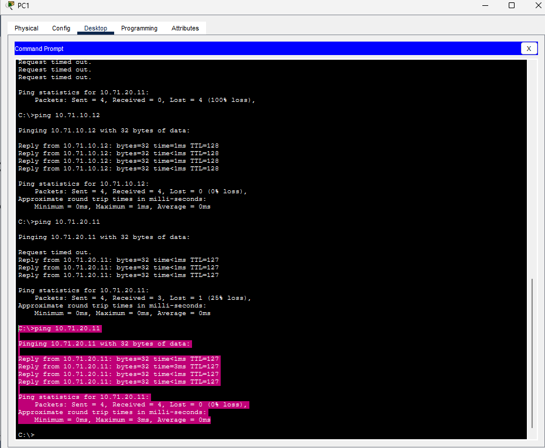 | 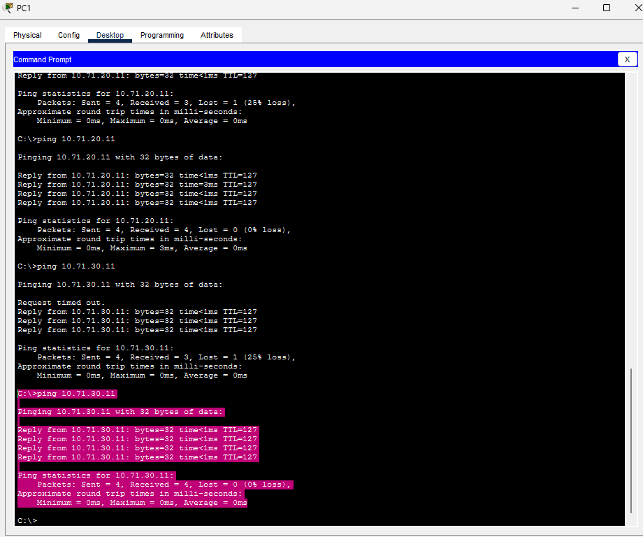 | 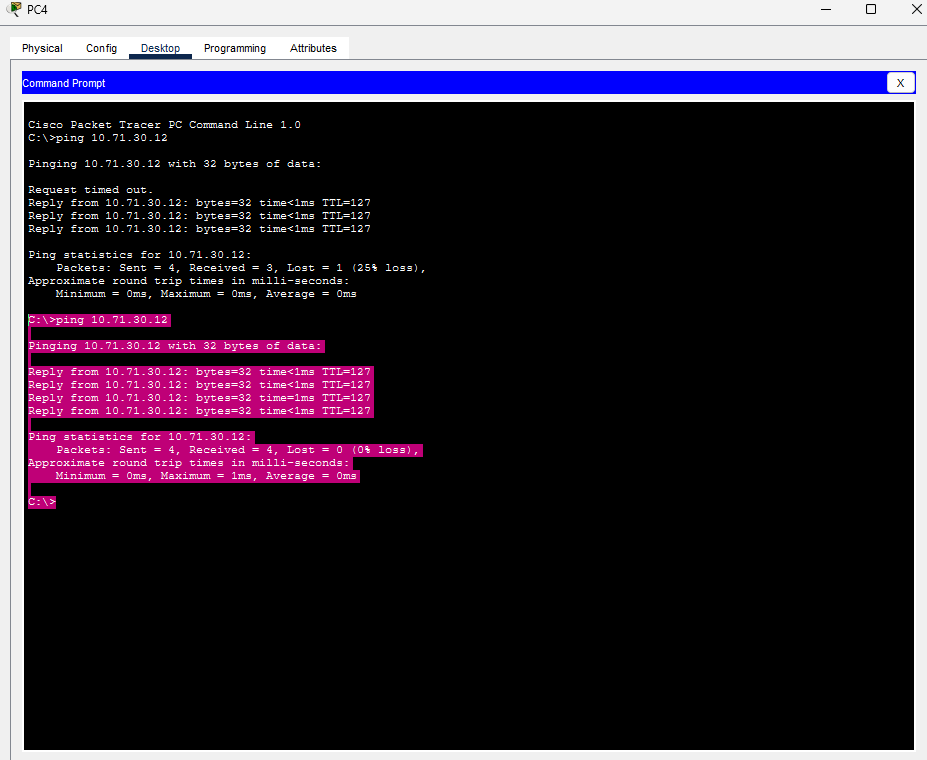 |

---

## 📂 Repository Structure

- 📁 `images/` — Complete step-by-step screenshots covering topology setup, IP settings, CLI verification, and ping results.
- 📄 `README.md` — Full documentation with command-by-command explanations and verification outputs.
- 📦 `campus-network.pkt` — Final Cisco Packet Tracer simulation file (saved with all startup configurations).

---

## 🎯 Final Checklist

- ✅ All devices deployed, labeled, and cabled with appropriate Straight-Through and Cross-Over links.
- ✅ Baseline security applied on `R1`, `SW1`, `SW2`, and `SW3` (`hostname`, `enable secret`, `console`, `vty`, `banner motd`, `service password-encryption`).
- ✅ Only VLANs `10`, `20`, and `30` created across all switches with VLAN `1` preserved as native.
- ✅ LACP EtherChannel (`Po1` and `Po2`) established in Active mode and carrying allowed VLANs `10,20,30`.
- ✅ Router-on-a-Stick configured on `R1` (`G0/0.10`, `G0/0.20`, `G0/0.30`) with all 6 connectivity tests passing.